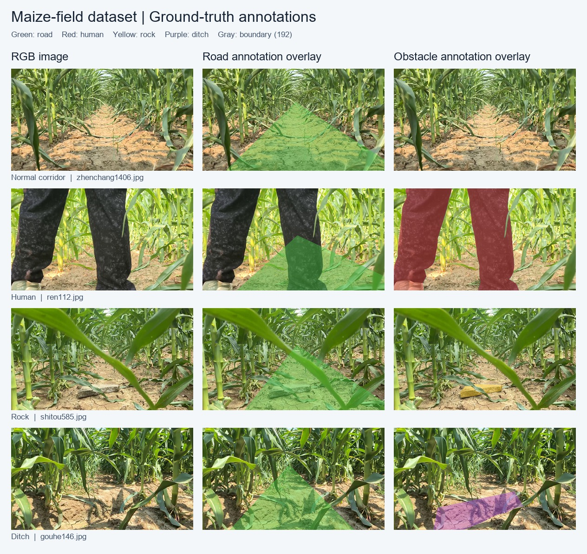

<div align="center">

# UC-TwinLiteFormer

### Lightweight dual-task segmentation for under-canopy maize navigation

[](https://doi.org/10.1016/j.compag.2026.112479)
[](#requirement)
[](#requirement)
[](LICENSE)

[Paper](https://www.sciencedirect.com/science/article/pii/S016816992601077X) · [中文说明](README_zh-CN.md) · [Dataset annotations](datasets/README.md) · [Citation](#citation)

</div>

## Introduction

This repository contains the **segmentation implementation** of UC-TwinLiteFormer for perceiving traversable corridors and obstacles in maize fields. A shared lightweight CNN–Transformer encoder feeds two decoders: a binary road head and a four-class obstacle head (background, human, rock and ditch).

**Paper:** *A lightweight dual-task transformer framework with geometry-constrained path extraction for autonomous under-canopy navigation in maize fields*  
**Authors:** Chao Wang, Yi Li, Shenhao Wang, Zihao Chen, Li Liang, Shuai Yang and Lichuan Gu  
**Journal:** Computers and Electronics in Agriculture, 2026, article 112479  
**DOI:** [10.1016/j.compag.2026.112479](https://doi.org/10.1016/j.compag.2026.112479)

The paper also introduces GCP-NLE for downstream navigation-line extraction. This release documents the supplied segmentation code, pretrained weight and dataset examples; it does not include a standalone reproduction of the complete navigation and control pipeline.

## Method

- Efficient spatial-pyramid convolutions and lightweight Swin Transformer V2 blocks form the shared encoder.
- Skip–Transformer Fusion (STF) and Lightweight Adaptive Feature Alignment Modules (LAFAM) combine features across stages.
- Separate decoders predict traversable road regions and obstacle categories.
- Training combines focal, Tversky and weighted Dice losses, with optional exponential moving average (EMA).

The network input is RGB, **640 × 384** (width × height). The two output tensors have 2 and 4 channels. For the supplied 1280 × 720 images, preprocessing produces a 640 × 360 image with 12 pixels of padding above and below; training and evaluation remove that padding when comparing predictions with masks.

## Results reported in the paper

| Model | Road mIoU (%) | Obstacle mIoU (%) | Parameters |
|---|---:|---:|---:|
| UC-TwinLiteFormer | 95.3 | 86.7 | 1.46 M |

These are published full-dataset results. The small example subset in this repository is intended for checking data formats and running the code, and does not reproduce the paper's benchmark. The supplied `medium` configuration contains **1,461,472 trainable parameters**.

## Requirement

This codebase has been developed with Python **3.8**, PyTorch **1.8.0** and torchvision **0.9.0**. Run the following commands inside a Python 3.8 environment.

```shell
pip install torch==1.8.0+cu111 torchvision==0.9.0+cu111 torchaudio==0.8.0 -f https://download.pytorch.org/whl/torch_stable.html
```

or

```shell
conda install pytorch==1.8.0 torchvision==0.9.0 torchaudio==0.8.0 -c pytorch
```

See `requirements.txt` for additional dependencies and version requirements.

```shell
pip install -r requirements.txt
```

Run the commands below from the repository root. CUDA is recommended for training. `demo.py` also supports CPU inference with `--device cpu`. OpenCV runs without GUI windows and writes the results to disk.

## Repository structure

```text
UC-TwinLiteFormer/
├── README.md
├── README_zh-CN.md
├── BDD100K.py                   # Paired image/road/obstacle data loader
├── train.py                     # Training and checkpointing
├── val.py                       # Segmentation evaluation
├── demo.py                      # Image/video inference and mask export
├── loss.py                      # Composite segmentation loss
├── IOUEval.py                   # Confusion-matrix metrics
├── utils.py                     # Training/evaluation helpers
├── model/
│   ├── model.py                 # Network, STF and LAFAM
│   ├── config.py                # Model scales and output classes
│   ├── swin_adapter.py
│   └── swin_transformer_v2.py
├── hyperparameters/
│   └── twinlitev2_hyper.yaml
├── pretrained/
│   └── best_model.pth           # Verified medium-model state dictionary
├── datasets/                    # Ten examples in each image/mask directory
├── docs/
│   └── dataset_examples.jpg     # Ground-truth annotation examples
└── tools/
    ├── check_dataset.py
    └── export_sample_dataset.py
```

Historical names such as `BDD100K`, `TwinLiteNetPlus`, `ll` and `lane_line_annotations` are retained for compatibility with the supplied implementation and checkpoint. In this project, the `ll` branch predicts **obstacles**.

## Dataset and annotations

The supplied full-data archive contains 4,040 training and 1,011 validation images (5,051 in total). This public package retains **10 images per data directory**, with matching basenames across RGB images and both annotation types.

```text
datasets/
├── images/
│   ├── train/                       # 10 JPG images
│   └── val/                         # 10 JPG images
├── drivable_area_annotations/
│   ├── train/                       # 10 road masks
│   └── val/                         # 10 road masks
├── lane_line_annotations/
│   ├── train/                       # 10 obstacle masks
│   └── val/                         # 10 obstacle masks
├── qufeng/                          # 10 auxiliary, unpaired demo images
├── sample_manifest.json             # Selected paths and SHA-256 checksums
└── README.md
```

Each train/validation sample consists of `images/<split>/<name>.jpg`, `drivable_area_annotations/<split>/<name>.png` and `lane_line_annotations/<split>/<name>.png`. Each split includes 3 normal-corridor, 3 human, 2 rock and 2 ditch examples. `qufeng/` is not read during training or evaluation.

| Task | Raw mask value | Meaning / output class |
|---|---:|---|
| Road | 0 | Background / 0 |
| Road | > 1 (128 and 192 in the examples) | Traversable region / 1, following the supplied loader |
| Obstacle | 0 | Background / 0 |
| Obstacle | 128 | Human / 1 |
| Obstacle | 255 | Rock / 2 |
| Obstacle | 64 | Ditch / 3 |

The original obstacle PNGs also contain **192-valued boundary pixels**. They are preserved byte for byte. The supplied training implementation leaves these pixels as all-zero one-hot targets; class-index conversion resolves them to background. They are not a fifth output class or a formal ignore-index mask. See [the annotation notes](datasets/README.md) before preparing new labels.



*Ground-truth examples, not model predictions. Green: road; red: human; yellow: rock; purple: ditch; light gray: original annotation boundary.*

Check the bundled examples:

```shell
python tools/check_dataset.py --expected-count 10
```

To use the full dataset, retain the same layout and pass `--data-root /path/to/datasets` to training or evaluation. The full dataset is not included in this package.

## Pretrained model

| Configuration | Weight | Classes |
|---|---|---|
| medium | [pretrained/best_model.pth](pretrained/best_model.pth) | Road: 2; obstacle: 4 |

This weight loads strictly into the supplied architecture. Always pair it with `--config medium`. Weights for the other configurations are not included.

## Training

```shell
python train.py --config medium --ema --max_epochs 100 --batch_size 4 --num_workers 0 --savedir runs/uc_twinliteformer
```

For a one-epoch execution check on the bundled examples:

```shell
python train.py --config medium --ema --max_epochs 1 --batch_size 2 --num_workers 0 --savedir runs/sample_check
```

For the full dataset, append `--data-root /path/to/datasets`. Hyperparameters are stored in `hyperparameters/twinlitev2_hyper.yaml`. Windows users can keep `--num_workers 0`; increase it as appropriate for the training machine.

The output directory contains `model_<epoch>.pth`, `best_model.pth` (selected by obstacle mIoU) and `checkpoint.pth.tar` (model, optimizer and optional EMA state). Resume an EMA training run with:

```shell
python train.py --config medium --ema --resume runs/uc_twinliteformer/checkpoint.pth.tar --savedir runs/uc_twinliteformer --num_workers 0
```

## Evaluation

```shell
python val.py --config medium --weight pretrained/best_model.pth --batch_size 2 --num_workers 0
```

The script reports road and obstacle segmentation statistics using the supplied metric implementation. Use the complete evaluation split and the paper's experimental protocol for benchmark comparisons. For exported overlays and masks, use `demo.py` below.

## Inference

Images or an image directory:

```shell
python demo.py --config medium --weight pretrained/best_model.pth --source datasets/images/val --save-dir inference/output
```

A video:

```shell
python demo.py --config medium --weight pretrained/best_model.pth --source path/to/video.mp4 --save-dir inference/output
```

Add `--device cpu` for CPU inference or `--half` for FP16 inference on CUDA. Images are letterboxed to the fixed network input, and predictions are restored to the original image dimensions. Output folders contain:

- `overlays/`: RGB/segmentation overlays.
- `road_masks/`: grayscale PNGs with values 0 and 255.
- `obstacle_masks/`: grayscale PNGs with values 0, 128, 255 and 64.
- `videos/`: annotated MP4 videos.

## Acknowledgements and license

This implementation builds on [TwinLiteNetPlus](https://github.com/chequanghuy/TwinLiteNetPlus), with Swin Transformer V2 components carrying Microsoft's original attribution. The upstream MIT license and source notices are retained; see [LICENSE](LICENSE) and [THIRD_PARTY_NOTICES.md](THIRD_PARTY_NOTICES.md).

## Citation

```bibtex
@article{wang2026uctwinliteformer,
  title   = {A lightweight dual-task transformer framework with geometry-constrained path extraction for autonomous under-canopy navigation in maize fields},
  author  = {Wang, Chao and Li, Yi and Wang, Shenhao and Chen, Zihao and Liang, Li and Yang, Shuai and Gu, Lichuan},
  journal = {Computers and Electronics in Agriculture},
  year    = {2026},
  pages   = {112479},
  doi     = {10.1016/j.compag.2026.112479},
  url     = {https://www.sciencedirect.com/science/article/pii/S016816992601077X}
}
```
