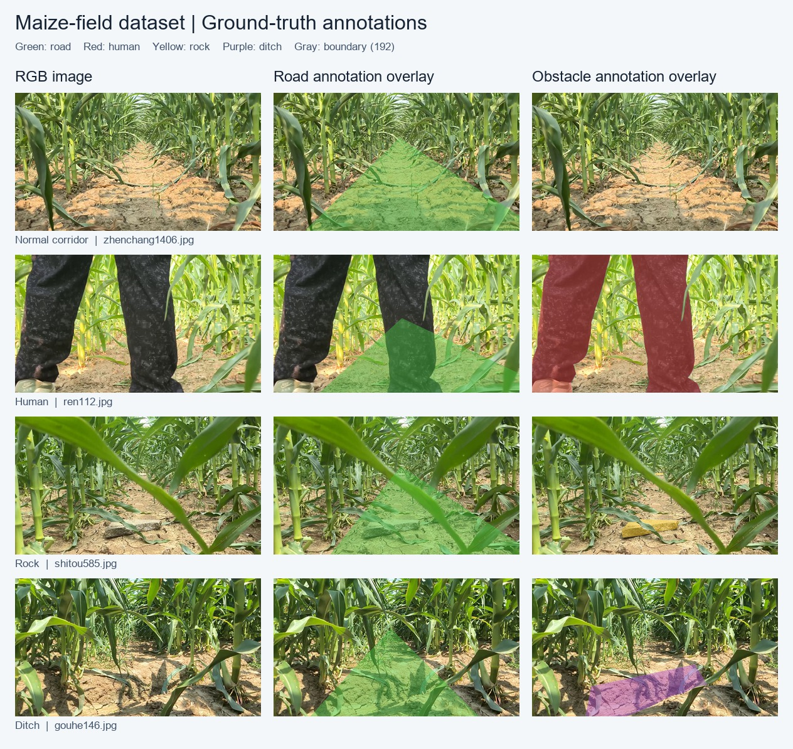

# UC-TwinLiteFormer

玉米冠层下导航场景的轻量化双任务语义分割模型。

[English](README.md) · [论文原文](https://www.sciencedirect.com/science/article/pii/S016816992601077X) · [标注说明](datasets/README.md)

## 论文与实现

**论文：** A lightweight dual-task transformer framework with geometry-constrained path extraction for autonomous under-canopy navigation in maize fields  
**作者：** Chao Wang, Yi Li, Shenhao Wang, Zihao Chen, Li Liang, Shuai Yang, Lichuan Gu  
**期刊：** Computers and Electronics in Agriculture，2026，112479  
**DOI：** [10.1016/j.compag.2026.112479](https://doi.org/10.1016/j.compag.2026.112479)

本仓库整理了论文的**分割部分**，包括模型、训练、验证、图片/视频推理、配套权重和数据样例。模型通过共享 CNN–Transformer 编码器和双分支解码器，同时预测可通行区域与障碍物；障碍物类别包括背景、行人、石块和沟壑。STF 与 LAFAM 用于特征融合。

论文还提出了 GCP-NLE 导航线提取方法；本次代码包不包含可独立复现完整导航与控制流程的实现。

论文报告可通行区域 mIoU 为 **95.3%**，障碍物 mIoU 为 **86.7%**，模型参数量约 **1.46 M**。本包 `medium` 配置的实际可训练参数量为 **1,461,472**。这些论文指标来自完整实验，不能通过仓库中的少量样例直接复现。

## 环境安装

使用 **Python 3.8、PyTorch 1.8.0、torchvision 0.9.0**。在 Python 3.8 环境中选择下面一种方式安装。

```shell
pip install torch==1.8.0+cu111 torchvision==0.9.0+cu111 torchaudio==0.8.0 -f https://download.pytorch.org/whl/torch_stable.html
```

或：

```shell
conda install pytorch==1.8.0 torchvision==0.9.0 torchaudio==0.8.0 -c pytorch
```

安装其他依赖：

```shell
pip install -r requirements.txt
```

以下命令均在仓库根目录执行。训练建议使用 CUDA GPU；图片和视频推理也可通过 `--device cpu` 在 CPU 上运行。程序直接保存结果，不依赖 OpenCV 图形窗口。

## 数据集

原始数据目录中有训练图像 **4,040 张**、验证图像 **1,011 张**，合计 **5,051 张**。本公开样例包每个图片/掩码文件夹只保留 **10 张**，完整备份数据不作删减。

```text
datasets/
├── images/
│   ├── train/                       # 10 张原图
│   └── val/                         # 10 张原图
├── drivable_area_annotations/
│   ├── train/                       # 10 张可通行区域掩码
│   └── val/                         # 10 张可通行区域掩码
├── lane_line_annotations/
│   ├── train/                       # 10 张障碍物掩码
│   └── val/                         # 10 张障碍物掩码
├── qufeng/                          # 10 张辅助图片，不参与训练和验证
├── sample_manifest.json
└── README.md
```

同一样本的原图和两套掩码保持相同文件名主干，例如 `ren112.jpg` 对应两套 `ren112.png`。训练、验证样例分别覆盖正常通道 3 张、行人 3 张、石块 2 张、沟壑 2 张，并保留原始训练/验证归属。共计 **30 张 RGB 图片和 40 张掩码，70 个图片文件**。

| 任务 | PNG 原始灰度值 | 含义 / 模型类别 |
|---|---|---|
| 可通行区域 | 0 | 背景 / 0 |
| 可通行区域 | > 1（样例中为 128、192） | 按原加载器作为可通行区域 / 1 |
| 障碍物 | 0 | 背景 / 0 |
| 障碍物 | 128 | 行人 / 1 |
| 障碍物 | 255 | 石块 / 2 |
| 障碍物 | 64 | 沟壑 / 3 |

原障碍物标注还包含灰度值 **192** 的轮廓边界，样例文件按原样保留。原训练代码没有将它设为第五类：这些位置的 one-hot 目标全为 0，转为类别索引时会得到背景类别；它们也不是独立的 ignore-index 标注。具体编码见[数据说明](datasets/README.md)。



图中为真实标注叠加：绿色为可通行区域，红色为行人，黄色为石块，紫色为沟壑，浅灰色为原始标注边界。

检查样例配对、数量、尺寸、灰度值和校验和：

```shell
python tools/check_dataset.py --expected-count 10
```

完整数据保持相同目录结构，训练、验证时增加 `--data-root 数据集根目录`。代码中的 `BDD100K.py`、`TwinLiteNetPlus`、`ll` 和 `lane_line_annotations` 是保留的历史名称，本项目的 `ll` 分支实际对应障碍物任务。

## 权重与训练

`pretrained/best_model.pth` 已验证与当前 **medium** 架构严格匹配。其他模型规格的权重未随包提供。

```shell
python train.py --config medium --ema --max_epochs 100 --batch_size 4 --num_workers 0 --savedir runs/uc_twinliteformer
```

仅检查程序流程时，可使用样例运行一个 epoch：

```shell
python train.py --config medium --ema --max_epochs 1 --batch_size 2 --num_workers 0 --savedir runs/sample_check
```

超参数文件为 `hyperparameters/twinlitev2_hyper.yaml`。Windows 可保持 `--num_workers 0`，其他机器可按资源调整。训练保存每个 epoch 的权重、按障碍物 mIoU 选择的 `best_model.pth`，以及包含优化器和可选 EMA 状态的 `checkpoint.pth.tar`。

断点续训示例：

```shell
python train.py --config medium --ema --resume runs/uc_twinliteformer/checkpoint.pth.tar --savedir runs/uc_twinliteformer --num_workers 0
```

## 验证

```shell
python val.py --config medium --weight pretrained/best_model.pth --batch_size 2 --num_workers 0
```

样例验证仅用于检查代码和数据格式。论文对比实验应使用完整评估集和对应实验协议。

## 图片和视频推理

```shell
python demo.py --config medium --weight pretrained/best_model.pth --source datasets/images/val --save-dir inference/output
```

```shell
python demo.py --config medium --weight pretrained/best_model.pth --source path/to/video.mp4 --save-dir inference/output
```

CPU 推理增加 `--device cpu`；CUDA 半精度推理增加 `--half`。程序将图像缩放、补边到 640 × 384，预测后恢复为原图大小。输出包括 `overlays/` 叠加图、`road_masks/` 二值掩码、`obstacle_masks/` 障碍物灰度掩码及 `videos/` 叠加视频。

## 致谢、许可和引用

代码基于 [TwinLiteNetPlus](https://github.com/chequanghuy/TwinLiteNetPlus) 扩展，保留了上游 MIT 许可和 Swin Transformer V2 的来源声明，详见 [LICENSE](LICENSE) 与 [THIRD_PARTY_NOTICES.md](THIRD_PARTY_NOTICES.md)。

论文 BibTeX 见 [英文 README](README.md#citation)，仓库亦提供 `CITATION.cff`。
